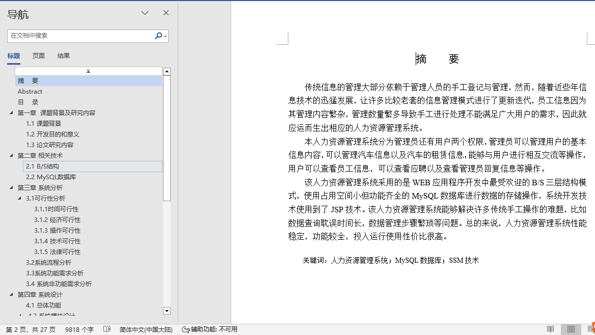
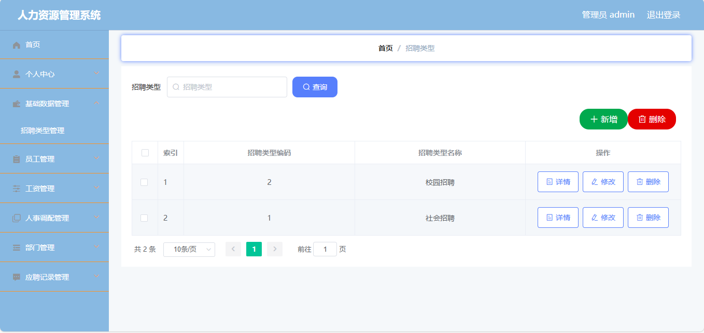
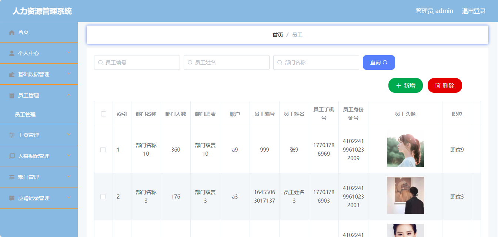
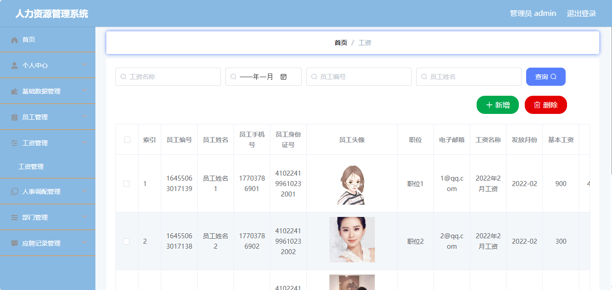
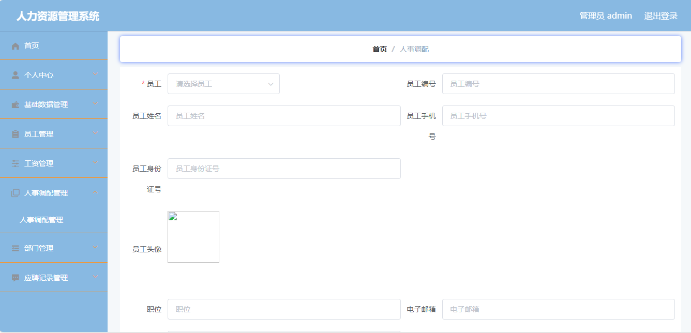
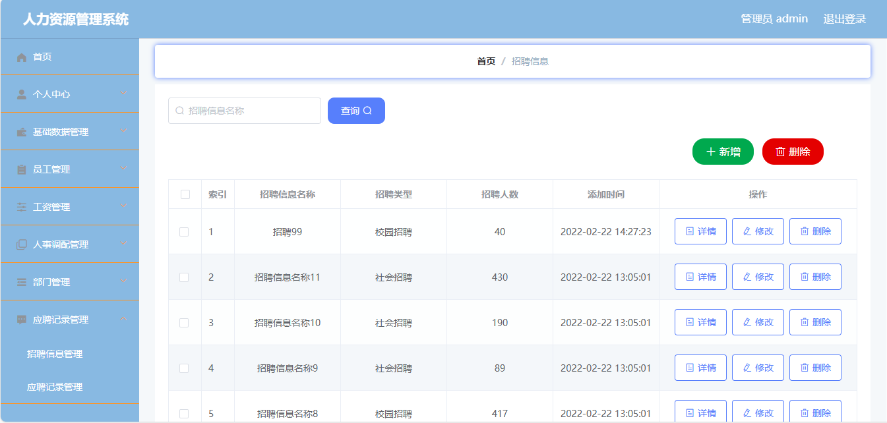
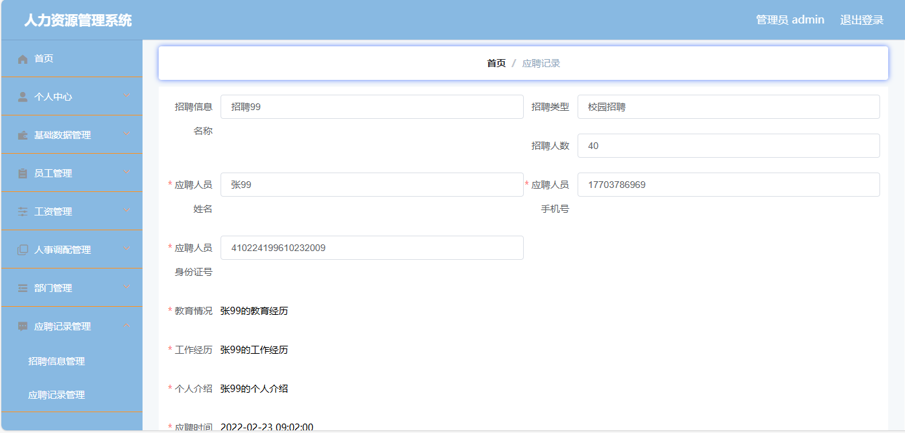
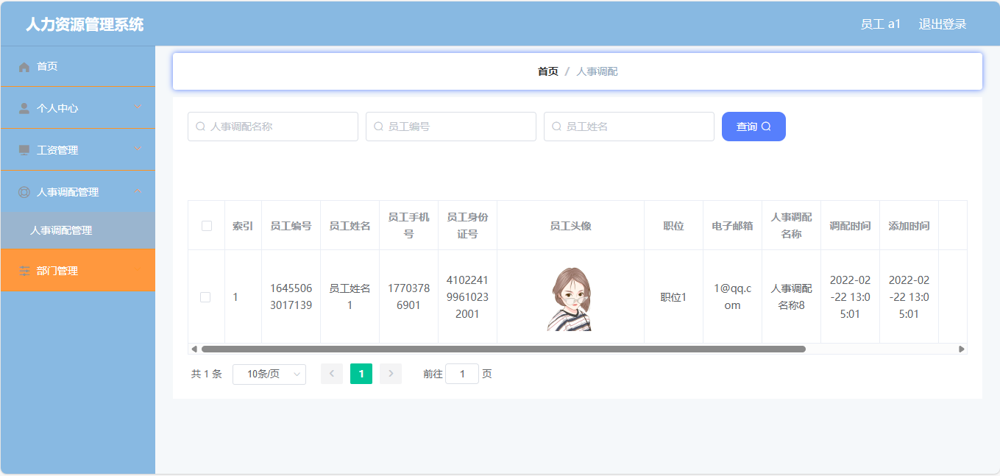
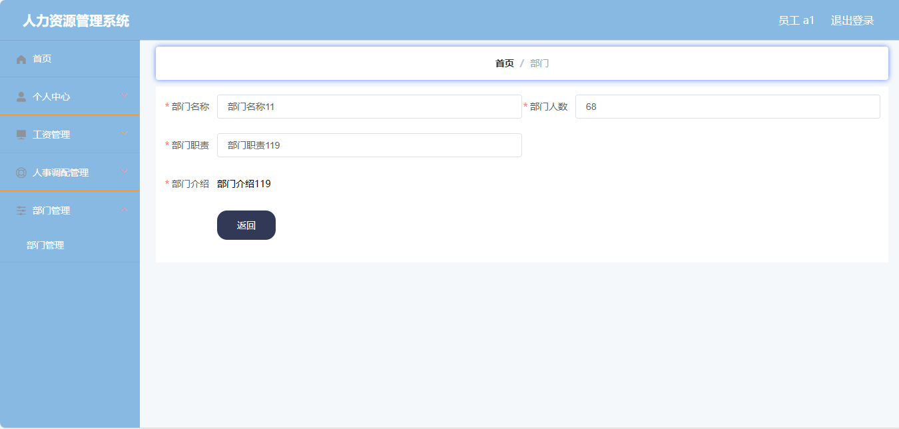

## 基于springboot的人力资源管理系统(程序+报告)

###  获取完整源码和sql数据库文件（完全免费）: 微信: littlepinia88 程序员蛙哥
###  所有项目以及源代码本人均调试运行无问题 可支持远程安装部署调试、定制修改、代码讲解

## 项目介绍

本项目是一个基于 Spring Boot + MyBatis-Plus 的人力资源管理系统，面向中小企业人事办公场景，采用「Vue + Element UI 管理端 + Spring Boot RESTful 后端」前后端分离架构，打通了部门设置、员工档案、工资核算、人事调配、招聘信息发布与应聘记录跟进的人事业务闭环。后端以 Java 8 + Spring Boot 2.2 提供 JSON 接口，前端为 vue-cli 构建的单页应用，打包产物内置在后端 `resources` 目录中，可直接作为课程设计、毕业设计或人事类管理系统的入门实践案例。

### 系统角色
- **管理员**：通过 `users` 账户登录后台，负责部门、员工、工资、人事调配、招聘、应聘记录以及数据字典、系统配置的全部维护。
- **员工**：通过 `yuangong` 账户注册、登录，可维护本人档案，并查询与自己相关的工资与人事调配记录。
- **权限控制**：由自定义 `AuthorizationInterceptor` 基于请求头 `Token` 鉴权，登录成功后由后端签发 Token 并写入 `token` 表；未携带有效 Token 的请求统一返回 401，登录、字典分页 `/dictionary/page` 与文件上传 `/file/upload` 放行。

### 用户端功能
1. **员工注册与登录**：通过 `/yuangong/register` 自助注册，`/yuangong/login` 登录后获取 Token，支持重置密码、查看会话 `/yuangong/session` 与退出登录。
2. **个人信息与相关记录**：登录后查看并维护本人档案（姓名、手机号、邮箱、照片），以及与本人关联的工资条、人事调配记录。

### 管理端功能
1. **部门管理**：维护部门名称 `bumen_name`、部门人数 `bumen_number`、部门职责 `bumen_zhize` 与部门介绍 `bumen_content`，支持分页、新增、编辑、删除与批量插入。
2. **员工档案**：按工号 `yuangong_uuid_number` 维护员工姓名、所属部门 `bumen_id`、职位 `zhiwei`、性别 `sex_types`、手机号、身份证号、邮箱与照片。
3. **工资管理**：按员工 `yuangong_id` 登记基本工资 `jiben_gongzi`、奖金 `jiangjin_gongzi`、实发工资 `shifa_gongzi` 与工资月份 `gongzi_time`。
4. **人事调配**：登记员工调配事项名称 `renshidiaopei_name`、调配内容 `renshidiaopei_content` 与调配时间 `diaopei_time`。
5. **招聘信息**：发布招聘职位名称 `zhaopinxinxi_name`、招聘类型 `zhaopinxinxi_types`、招聘人数 `zhaopinxinxi_number` 与岗位职责。
6. **应聘记录**：登记应聘者姓名、电话、身份证号、教育经历、工作经历以及面试结果 `mianshi_jieguo_types`，并关联对应招聘职位 `zhaopinxinxi_id`。
7. **数据字典与系统配置**：维护性别、面试结果等下拉枚举（`dictionary`）与系统参数（`config` 表的 `name`/`value`），供表单动态渲染。

### 技术栈
- **后端框架**：Spring Boot 2.2.2.RELEASE、Spring MVC、MyBatis-Plus 2.3（mybatis-spring-boot-starter 2.1.1）
- **数据访问**：MySQL（库 `a002_renliziyuanguanli`），MyBatis-Plus 注解 + XML Mapper（`classpath*:mapper/*.xml`）
- **前端**：Vue 2.6 + Element UI 2.13 + vue-router + axios + ECharts 4.6 + vue-quill-editor 富文本 + vue-json-excel 导出
- **工程能力**：`AuthorizationInterceptor` Token 鉴权、`@IgnoreAuth` 注解放行、POI Excel 导入导出、Hutool 工具、FastJson、统一跨域响应头
- **构建运行**：Maven `spring-boot-maven-plugin` 打包可执行 jar；前端使用 @vue/cli-service 4.1 构建，dev server 端口 8081 代理到后端 8080

### 核心数据表
- `users` 管理员表：`username`、`password`、`role`、`addtime`
- `yuangong` 员工表：`username`、`password`、`bumen_id`、`yuangong_uuid_number`、`yuangong_name`、`yuangong_phone`、`yuangong_id_number`、`zhiwei`、`sex_types`
- `bumen` 部门表：`bumen_name`、`bumen_number`、`bumen_zhize`、`bumen_content`
- `gongzi` 工资表：`yuangong_id`、`gongzi_time`、`jiben_gongzi`、`jiangjin_gongzi`、`shifa_gongzi`
- `renshidiaopei` 人事调配表：`yuangong_id`、`renshidiaopei_name`、`diaopei_time`
- `zhaopinxinxi` 招聘信息表：`zhaopinxinxi_name`、`zhaopinxinxi_types`、`zhaopinxinxi_number`
- `yingpinjilu` 应聘记录表：`zhaopinxinxi_id`、`yingpinjilu_name`、`mianshi_types`、`mianshi_jieguo_types`
- `dictionary` 字典表：`dic_code`、`dic_name`、`index_name`、`super_id`
- `config` 系统配置表：`name`、`value`

### 工程结构
```
A002renliziyuanguanli
├── src/main/java/com
│   ├── controller/      REST 控制器（部门、员工、工资、调配、招聘、应聘、字典、用户）
│   ├── service/         业务接口与 impl 实现
│   ├── dao/             MyBatis-Plus Mapper 接口
│   ├── entity/          实体类（含 model/vo/view 子包）
│   ├── interceptor/     AuthorizationInterceptor Token 鉴权
│   ├── config/          拦截器注册、MyBatis-Plus 配置、自动填充
│   ├── annotation/      @IgnoreAuth 放行注解
│   └── utils/           R 响应封装、文件等工具
├── src/main/resources
│   ├── application.yml   端口 8080、上下文 /renliziyuanguanli、数据源
│   ├── mapper/          MyBatis XML 映射
│   ├── static/upload/    上传文件目录
│   └── admin/admin/      Vue 管理端工程（src 源码 + dist 打包产物）
└── pom.xml
```

### 访问入口
- 后端接口：`http://localhost:8080/renliziyuanguanli/`（如 `/users/login`、`/yuangong/page`）
- 前端开发调试：`http://localhost:8081/`（vue.config.js devServer，代理 `/renliziyuanguanli` 到 8080）

### 补充说明
- 数据库账号密码默认为 root/123456，首次运行需先创建并导入 `a002_renliziyuanguanli` 库结构。
- 鉴权为自研 Token 机制（登录信息落 `token` 表），虽引入了 shiro-spring 依赖但未配置 Shiro Realm；密码以明文形式入库，仅适合教学演示。
- 前端 Vue 工程位于 `src/main/resources/admin/admin/`，生产态使用其 `dist/` 静态产物由 Spring Boot 直接托管。

## 运行环境
- JDK版本：JDK1.8及以上
- 开发工具：IDEA、Ecplise、Myecplise都可以
- 数据库: MySQL5.7及以上
- Node：14.14.0及以上

## 运行截图


















